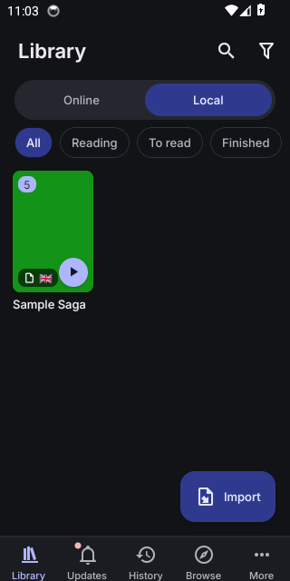
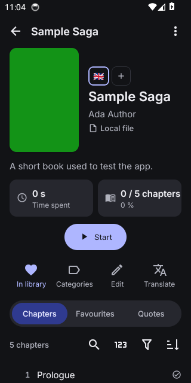
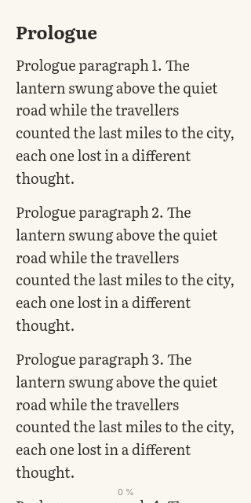
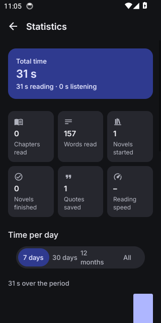

# LNBook

Android reader for light novels and web novels. Import EPUB and TXT files, follow online
sources, read offline, listen with the speech engine of the phone, translate between
English and French, and keep your favourite passages.

<p>
  
  
  
  
</p>

## Features

- **Library**: imported files and online novels, categories, sort, filters, grid or list.
- **Reader**: scroll or page mode, themes, fonts, margins, exact position kept, search,
  text replacement rules, chapter editing, volume keys.
- **Sources**: runs the source plugins of
  [LNReader](https://github.com/LNReader/lnreader-plugins) unchanged, with global search,
  web view and Cloudflare checks.
- **Downloads**: queue in the background, storage management, new chapter checks with
  notifications, EPUB 3 export.
- **Voice**: reads chapters aloud, screen off, with media controls and a sleep timer.
- **Translation**: on the phone with Google ML Kit (offline once the model is downloaded),
  or with your own DeepL key; glossary per novel, bilingual display.
- **Quotes**: save passages in folders, come back to the exact place, share as an image.
- **Statistics**: time per chapter, per novel and overall, streaks, reading speed.
- **Backups**: manual or automatic, LNReader backup import, app updates from GitHub.

Everything stays on the phone: no account, no analytics.

## Install

1. Download the latest `LNBook-vX.Y.Z.apk` from the
   [Releases](https://github.com/RedCodeSnoo/LNBook/releases) page (a `.sha256` file is
   published next to it).
2. Open it on your phone (Android 8.0 or newer). The first time, Android asks you to allow
   installing apps from this source.

Later versions can be installed from the app itself: **Updates** tab, or **More → About →
Check for updates**. Your data is kept.

## Build

```sh
npm ci
npm run prebuild
cd android && ./gradlew assembleRelease
```

## License

MIT. Online sources are provided by the plugins of
[LNReader/lnreader-plugins](https://github.com/LNReader/lnreader-plugins) (MIT).
